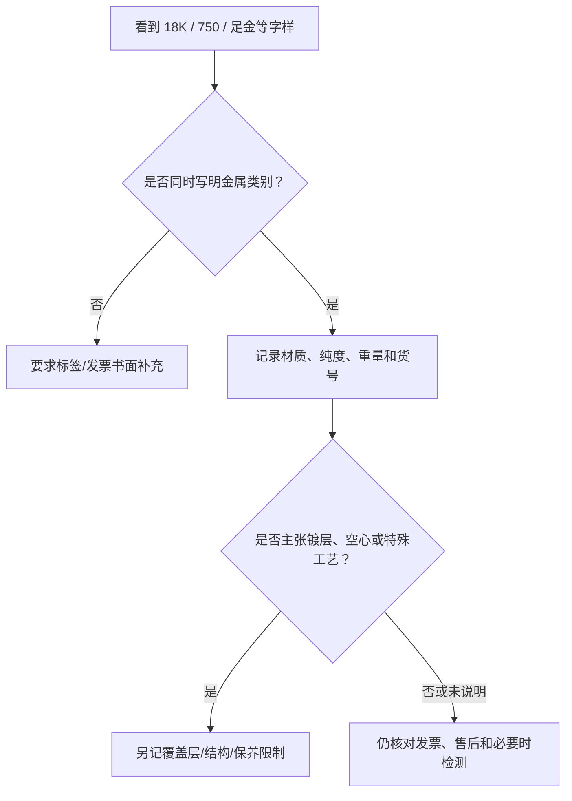

# 第 36 章 贵金属基础：读懂材质、纯度与印记

“白色”“不褪色”“18K”“足金”分别在说颜色、耐久性、合金配比或标准命名，不能互相替代。买首饰时，
先把金属种类、纯度表达、表面状态和证据链拆开，才不会把一件外观相似的饰品当成另一种材料。

## 36.1 金属、合金与首饰：材料不是颜色

常见贵金属首饰以金（Au）、铂（Pt）、钯（Pd）或银（Ag）为基体；实际首饰常是合金，以取得强度、
颜色、铸造和加工所需的性能。合金中加入什么、加多少，会影响颜色、硬度、延展性、过敏风险和维修表现，
因此“某种金属”与“某种颜色”是两道不同问题。

| 先问什么 | 能回答什么 | 不能单独回答什么 |
|------|------------|------------------|
| 材质标示（Au / Pt / Pd / Ag 等） | 声称的主要贵金属类别 | 实际含量是否符合、是否有镀层 |
| 纯度或 K 数 | 声称的合金组成表达 | 戒壁厚度、是否空心、镶嵌牢度 |
| 颜色与表面光泽 | 当前外观 | 基体一定是何种金属、未来是否磨耗 |
| 发票、标签、报告 | 交易中可追溯的书面信息 | 所有维修、回收或保值结果 |

“纯度”不等于“更适合”。高纯度金通常更软，复杂镶嵌、细爪或日常高摩擦场景还需要看设计、合金体系和
工艺；反过来，较低纯度或白色外观也不表示做工差。具体适配性要回到首饰结构。

## 36.2 K 金与千分数：两种表达，不要混读

K 金（karat gold）用 24 个份额表示金在合金中的份额：例如 **18K 的名义概念是 18/24 为金**，其余为
其他金属。千分数则直接以每千份中的贵金属含量表达。两者都必须连同金属类别、销售标签和适用标准来读；
不要把宝石重量单位“克拉（ct）”与 K 金混为一谈。[^karat]

中国市场的贵金属首饰命名与纯度标示应以现行 **GB 11887** 及其修改、商品标签和销售凭证为准。该标准的
第一号修改单已调整“千足”类称谓；标准状态和适用表述会更新，购买时不要用旧吊牌、旧攻略或他人首饰的
印记推断新货的合规表达。[^gb]

## 36.3 白 K 金、铂金与钯金：白色只是外观线索

白 K 金是以金为主要贵金属的白色合金，表面也可能另有镀层；铂金是以铂为主要贵金属的合金；钯金则是以钯
为主要贵金属的合金。三者都可能呈白色或灰白色，但它们不是同一种材料。颜色会受合金、抛光、镀层、磨耗
和环境影响，不能据“看起来更白”下身份结论。

银色饰品同样不自动等于铂、钯或白 K 金。对“白金”这类口头词，最有效的追问不是“白不白”，而是：
**印记写的元素是什么？纯度怎么写？是否有表面覆盖层？这些信息是否进入发票？**

## 36.4 印记是起点，不是验真终点

印记通常位于戒圈内侧、扣头、吊坠背面等位置，可记录金属类别、纯度或厂商信息。它可能因尺寸、工艺、
磨损、维修或局部结构而不易读取；看不到印记也不能直接断言材料有问题。反过来，看到印记也不应把它当成
对成分、重量、镀层和真伪的独立检验证明。

建议在付款前建立一张最小证据卡：

| 字段 | 要记录的内容 |
|------|--------------|
| 物件身份 | 品名、货号、照片、尺寸与可见印记 |
| 金属声明 | 金属类别、纯度表达、是否覆层/镀层 |
| 重量边界 | 标称重量、是否含宝石/配件、允许误差如何写 |
| 交易证据 | 价签、发票、检测报告编号及查询结果 |
| 售后 | 改圈、翻新、补镀、维修和退换条件 |

贵重或信息矛盾的物件，应询问可复核的检测与售后路径；隔着照片、靠磁铁、颜色或单一印记都不能作成分
鉴定结论。

## 36.5 常见说法辨析

| 说法 | 判定 | 为什么 |
|------|------|--------|
| “白色金属就是铂金” | **明确错误** | 白 K 金、钯金、银及不同覆盖层都可能呈白色。 |
| “18K 就是镀了一层金” | **明确错误** | K 数描述金合金的组成表达；镀层是另一项表面结构信息。 |
| “印记在，就无需看发票或报告” | **不准确** | 印记、交易凭证和检测各回答不同问题，仍要核对货号与具体物件。 |
| “纯度越高一定越耐戴、越值” | **不准确** | 耐戴还取决于合金、厚度、结构、镶嵌和使用场景；价格还包含工费等。 |

## 36.6 🔎 柜台前的用处

1. 先让销售把金属类别、纯度、是否有镀层写进价签或发票；
2. 把“白金”“不掉色”“高纯度”等口头词翻译成可核验字段，不接受混合表达；
3. 记录印记的位置与文字，但不以印记代替检测和交易凭证；
4. 询问总重是否含宝石、扣件或其他配件，并把重量口径留存；
5. 复杂镶嵌或常戴首饰同时问维修、改圈、翻新和补镀的条件与费用。

## 36.7 思考题

1. 为什么“18K”和“镀金”不能互相解释？
2. 为什么白色外观不足以判断是白 K 金、铂金还是钯金？
3. 【案例】价签写“白金钻戒”，销售口头说“18K、永不褪色”，但发票只有总价和“戒指”。付款前你怎样把信息补齐？

> 📖 **参考答案**（想清楚再看）：[Q1](../../qa/36-precious-metals-qa.md#q1) · [Q2](../../qa/36-precious-metals-qa.md#q2) · [Q3](../../qa/36-precious-metals-qa.md#q3)

## 36.8 本章实操

### 🅐 无器具版

选三件商品页或自己已有的金属首饰，按“金属类别、纯度表达、印记、是否覆层、重量口径、发票字段、
售后承诺”做对照表。将无法从书面资料找到的字段标成“待问”，而不是自行补全。

### 🅑 有器具版

备齐后再做：用 10 倍镜和手机微距记录印记及其位置、戒圈接缝、扣头和高摩擦区域；用电子秤仅记录整件
重量，不从重量反推金属含量。不要做酸试、刮擦、火烧或自行剥离覆盖层；贵重件由合格检测机构按适配方法
检验。

## 36.9 本章主要参考

| 来源 | 本章用途 |
|------|----------|
| [国家标准信息公共服务平台：GB 11887-2012](https://openstd.samr.gov.cn/bzgk/std/newGbInfo?hcno=160D097531C48C91014D54AEA0D0671A&refer=outter) | 贵金属首饰纯度与命名标准的现行公开状态；结合第一号修改单阅读 |
| [全国标准信息公共服务平台：GB 11887 第一号修改单](https://std.samr.gov.cn/gb/search/gbDetailed?id=71F772D7EFA7D3A7E05397BE0A0AB82A) | 修改单生效信息与“千足”类表述的版本边界 |
| [FTC：Jewelry Guides](https://www.ftc.gov/business-guidance/resources/loupe-advertising-diamond-gemstones-pearls) | K 金、金属名称与清楚披露的消费者教育交叉参照；不替代中国规则 |

[^karat]: [克拉](../../glossary.md#carat)是宝石重量单位；K 金的 karat 是合金纯度表达，中文交易中必须看上下文。
[^gb]: 标准条文、修改单和监管要求以购买时的有效版本及销售地适用规则为准。
