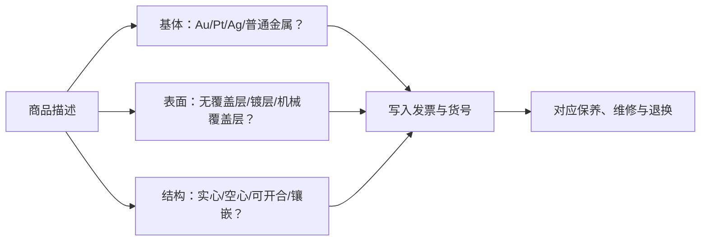

# 第 37 章 镀层、覆盖层与空心件：外观之外还要看结构

“不掉色”“包金”“厚镀”“白金色”“实心”是不同维度的说法。有的描述表面，有的描述覆盖层的制作方式，
有的描述内部空间；它们都不能仅凭照片或颜色验证。本章的目标不是教人自行破坏性验货，而是把卖方声明
翻译成可写入凭证、可用于保养和售后的字段。

## 37.1 四类结构先分开

| 类别 | 核心是什么 | 不能从词语自动推出什么 |
|------|------------|------------------------|
| 整体贵金属合金首饰 | 主体由声明的贵金属合金构成 | 是否空心、是否另有表面处理 |
| 电镀/表面镀层 | 在基体表面形成一层金属 | 基体一定贵金属、永不磨耗 |
| 机械覆盖层 | 以机械方式把金属层结合在基体上 | 覆盖层厚度、重量比例或各地术语完全相同 |
| 空心/电铸结构 | 物件内部有空腔或由沉积成形 | 外层材料、承压能力、是否可随意改圈 |

一个物件可同时属于多个类别：例如白 K 金戒指可以有镀铑表面；空心件也可以是贵金属合金或有覆盖层。
因此，遇到“实心金”“厚镀金”“包金”时，要分别问基体、表面和内部结构，而非只记一个营销词。[^coverage]

## 37.2 镀层会磨耗：这是材料行为，不是自动质量事故

白 K 金常见的镀铑可提升白亮外观；银也可能镀铑以减缓失去光泽。日常摩擦、汗液、化妆品、清洁剂、
尺寸调整和反复抛光都可能使表层逐渐变化，露出基体的原有色调或让不同部位观感不一致。具体磨耗速度没有
通用天数：厚度、佩戴频率、摩擦位置、皮肤与化学暴露都会改变结果。[^rhodium]

“可补镀”是服务能力，不等于可以忽略结构与售后。补镀前应问清：是否需要拆石或抛光、会不会改变尺寸或
印记、哪些部位覆盖、费用和预计周期如何计算。对有珍珠、祖母绿、胶粘结构或其他护理限制的首饰，维修前
尤其要主动说明材料与已知处理。

## 37.3 覆盖层术语：先记录卖方怎么定义

不同市场与标准对 gold plated、gold filled、rolled gold plate、gold overlay、vermeil 等词会规定不同的
材料、工艺、厚度或标示条件。以美国 FTC 的消费者资料为例，gold filled / gold overlay / RGP 指机械方式
施加在基体上的金合金层；vermeil 是银基体上的镀金类别。它们是理解“基体 + 表层 + 披露”的有用参照，
**不是对中国商品的自动定名或合规结论**。[^ftc]

在中国购买时，以适用的 GB 11887、QB/T 2997、现行商品标示和销售凭证为准。最实用的做法是要求商家写清：
基体是什么、表层是什么、采用何种工艺、是否声称厚度/重量比例、该声明对应哪份检测或产品资料。只写
“包金”“保色”“不褪色”而没有这些字段时，无法与另一件商品做可靠比较。

## 37.4 空心不等于假，重也不等于实

空心与电铸可在较少材料下实现较大体积或复杂造型；它们不是假货标签，但通常更怕挤压、凹陷、反复改形或
不当维修。整体重量还会受到宝石、扣件、内衬、空腔和尺寸的影响，不能单凭“同样大却更轻/更重”判断贵金属
含量。称重只能记录，不是成分检测。

对于手镯、粗链、耳饰和大体积吊坠，可直接问：是否空心、电铸还是实心；受力和易磨部位在哪里；是否建议
改圈、焊接或超声清洗；发生压瘪、断裂或镀层磨耗时的维修方案。答案应与书面售后条款一致。

## 37.5 常见说法辨析

| 说法 | 判定 | 为什么 |
|------|------|--------|
| “白金色就是铂金，永远不变色” | **明确错误** | 白 K 金、银和镀层均可呈白色；表面状态还会随磨耗变化。 |
| “镀层磨了就是假货” | **不准确** | 镀层本身是表面结构，会受摩擦与使用条件影响；关键是原先是否如实披露及售后是否兑现。 |
| “包金一定比镀金厚很多” | **缺乏脱离标准的统一结论** | 术语、工艺和声明条件因市场而异；应看适用标准和卖方给出的可核验数据。 |
| “空心件一定不值钱” | **不准确** | 空心是结构选择，价值还取决于材料、设计、工艺、耐久性和交易条件；但维修边界应被清楚披露。 |

## 37.6 🔎 柜台前的用处

1. 把“白金色/包金/保色”拆成基体、表面金属、工艺和结构四项；
2. 询问高摩擦区（戒圈底部、扣头、边缘）发生磨耗后的外观和维修方案；
3. 对声称“厚镀”或“包金”的商品，请求其书面厚度、比例或适用标准说明；
4. 对大体积件询问是否空心、电铸、能否改形和受损后的维修限制；
5. 在发票或订单留存材质、覆盖层、货号、重量口径及补镀/维修/退换承诺。

## 37.7 思考题

1. 为什么“有镀层”和“基体是贵金属”必须分开记录？
2. 为什么不能承诺所有镀层在固定时间后都会磨掉？
3. 【案例】一对耳环商品页写“18K 金色、厚镀、轻盈不压耳”，客服称“绝不掉色”，却不能说明基体和是否空心。你怎样判断和行动？

> 📖 **参考答案**（想清楚再看）：[Q1](../../qa/37-plating-and-hollow-qa.md#q1) · [Q2](../../qa/37-plating-and-hollow-qa.md#q2) · [Q3](../../qa/37-plating-and-hollow-qa.md#q3)

## 37.8 本章实操

### 🅐 无器具版

挑选四个商品页，建立“基体 / 表面金属 / 工艺词 / 是否空心 / 厚度或比例证据 / 保养 / 售后”表。若页面只有
颜色词或“保色”承诺，将该格标为“未披露”，并写出付款前要问的问题。

### 🅑 有器具版

备齐后再做：用 10 倍镜与侧向光记录戒圈底部、扣头、尖边和焊接处的颜色、划痕与可见磨耗；拍照作为以后
售后比对的初始记录。不要刮磨、酸洗、火烧、弯折或剥离表层；这些方法既会损坏货品，也不足以可靠判定
基体与覆盖层厚度。

## 37.9 本章主要参考

| 来源 | 本章用途 |
|------|----------|
| [GIA：White Gold vs. Silver](https://4cs.gia.edu/en-us/blog/white-gold-vs-silver/) | 白 K 金/银常见镀铑、表面磨耗与保养的消费者教育 |
| [FTC：Buying Platinum, Gold, and Silver Jewelry](https://consumer.ftc.gov/articles/buying-platinum-gold-and-silver-jewelry) | 覆盖层、gold filled、vermeil 与空心/实心词的美国消费者教育参照 |
| [FTC：Jewelry Guides](https://www.ftc.gov/news-events/topics/tools-consumers/jewelry-guides) | 金属与覆盖层必须准确披露的原则；不替代中国规则 |

[^coverage]: 覆盖层术语的具体定名和标示要求，参见[贵金属覆盖层饰品](../../reference/standards.md)列出的 QB/T 2997 与销售地有效规则。
[^rhodium]: 磨耗时间受多因素影响；任何固定“保色天数”都应要求商家说明适用条件和售后。
[^ftc]: 海外术语示例用于理解披露结构；跨境购买还要核对目的地规则及卖方实际承诺。
