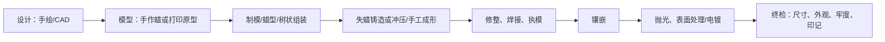

# 第 38 章 首饰制造工艺：工艺名称不是质量结论

铸造、车花、冲压、执模、抛光、电镀、3D 打印是制造链上的不同环节。它们能解释造型如何实现、哪里可能
需要重点检查、以后怎样维修，却不能单独把一件首饰判为“高级”或“廉价”。评价完成品仍要看材料披露、
结构、表面、镶嵌、尺寸、重量口径和售后。

## 38.1 从设计到交付：一件首饰经过哪些关口

大批量生产可能用模具复制蜡型，再经失蜡铸造；也可能使用冲压、拉丝、焊接和手工成形。CAD 与 3D 打印
通常改变的是设计验证和原型/蜡型的取得方式，不会取消铸造、修整、镶嵌、抛光和质量控制。GIA 对工厂流程的
公开报道也展示了“设计—原型—蜡型—铸造—镶嵌—抛光—终检”的连续链条。[^gia-flow]

## 38.2 失蜡铸造：适合复杂造型，也需要后续质量控制

失蜡铸造可概括为：先得到可牺牲的蜡型（或可烧失树脂模型），包埋形成型腔，去除模型后将熔融金属注入，
最后取件、修整和精加工。它适合复杂、重复或难以直接手工成形的造型；并不意味着每一件都有同样的表面和
内部质量。

浇口设计、温度、合金、包埋与烧失、冷却和后续修整都会影响结果。铸造缺陷可能包括未充满、收缩或气孔、
夹杂、粗糙表面等；成品上的针孔、异常粗糙、明显补焊痕或薄弱边缘值得记录并向商家询问，但仅凭肉眼不能
确定缺陷成因或内部状态。[^casting]

## 38.3 执模、焊接与抛光：看“边界是否被照顾”

执模是将铸件修整到设计尺寸和轮廓的过程，常涉及去浇口、锉修、砂磨和局部修补；焊接用于连接部件或维修。
抛光则改善表面反射，但会移除极少量表层金属，过度抛光可能削弱尖角、花纹、爪或印记。表面越亮并不自动
表示结构越可靠。

柜台可观察的不是“有没有手工味”，而是：左右是否对称、连接是否顺畅、边缘是否刮手、镶口周围是否有
残留抛光膏、可见孔洞或严重拉痕、活动部件是否顺畅。观察结果是售后沟通线索，不是隔屏鉴定报告。

## 38.4 电镀与其他表面处理：最后一步也会放大前道问题

电镀会在基体上沉积金属层，用于颜色、光泽或表面性能。其均匀性和附着力依赖基体清洁度、前处理、电流、
溶液及形状；尖边、凹槽和隐蔽面尤其可能出现厚度差异。电镀不能可靠地“遮住”铸造气孔、划痕或糟糕抛光，
反而可能让这些问题在后续磨耗中显现。[^plating]

所以检查表面时要把“镜面程度”与“表面完整性”分开：镜面可由抛光/镀层带来；孔洞、裂纹、起皮、明显色差
或残留物则需要独立记录和处理。

## 38.5 3D 打印带来什么，没有带来什么

3D 打印可用于树脂原型、可烧失模型、夹具或直接金属制造，优势是迭代快、复杂几何可实现、定制沟通更直观。
但打印精度、支撑痕、烧失残留、铸造收缩、后处理和最终镶嵌仍会影响完成品。看到“3D 打印”应理解为一段
制造路线，而不是纯手工/非手工、真材实料/非真材实料的分界线。

定制件尤其应在开工前确认：设计图与最终尺寸、材料和纯度、宝石是否客户自带、允许重量/尺寸偏差、改稿次数、
余料归属、交付前验收点及返工条件。

## 38.6 常见说法辨析

| 说法 | 判定 | 为什么 |
|------|------|--------|
| “铸造件一定比手工件差” | **不准确** | 两者是制造路线；设计、合金、质量控制、修整与镶嵌决定具体完成度。 |
| “3D 打印就是塑料首饰” | **明确错误** | 打印可用于原型或可烧失模型，最终件可经铸造制成金属；必须问最终材料和工艺链。 |
| “抛得越亮，做工越好” | **不准确** | 抛光只是一项表面步骤；还要看孔洞、边缘、接缝、结构和镶嵌。 |
| “电镀能永久遮住铸造瑕疵” | **明确错误** | 镀层依赖基体状态，缺陷可能仍存在或在磨耗后显露。 |

## 38.7 🔎 柜台前的用处

1. 问清是现货、改款还是定制；定制件保留确认过的图纸与规格；
2. 用侧光看接缝、尖边、孔洞、划痕、左右对称和活动部件，而非只在柜台强光下看；
3. 对铸造复杂件，询问薄弱处、可否改圈/焊接和发生变形后的维修边界；
4. 对表面色差、起皮或可见孔洞，先拍照并要求书面处理方案；
5. 不把“手工”“3D”“电铸”当作价格理由本身，要求对应到材料、设计、工时或售后。

## 38.8 思考题

1. 为什么“铸造”和“3D 打印”都不能直接决定首饰好坏？
2. 为什么抛光与电镀不能替代对结构和镶嵌的检查？
3. 【案例】定制戒指宣传“3D 打印一体成型、无瑕疵”，交货时戒壁有针孔、边缘锐利。你如何记录、追问和处理？

> 📖 **参考答案**（想清楚再看）：[Q1](../../qa/38-manufacturing-qa.md#q1) · [Q2](../../qa/38-manufacturing-qa.md#q2) · [Q3](../../qa/38-manufacturing-qa.md#q3)

## 38.9 本章实操

### 🅐 无器具版

找一件现货与一件定制商品，分别列出“设计确认、材料、模型/制造、镶嵌、表面处理、终检、售后”的已知
信息。没有书面确认的项目一律标“未知”；为定制件写一份交付验收清单。

### 🅑 有器具版

备齐后再做：在不直视强光的条件下，以 10 倍镜和侧向光检查已拥有首饰的接缝、边缘、花纹、孔洞和活动件，
只记录可见事实与位置。不要用针挑孔、弯折、敲击、酸洗或自行抛光；疑似裂纹、松动或严重表面缺陷应交由
商家/维修方评估。

## 38.10 本章主要参考

| 来源 | 本章用途 |
|------|----------|
| [GIA：深圳珠宝制造业报道](https://www.gia.edu/gia-news-research/shenzhen-china-gem-jewelry-industry) | CAD/原型、蜡型、铸造、镶嵌、抛光、终检的工厂流程实例 |
| [GIA：Jaipur 珠宝制造报道](https://hongkong.gia.edu/gia-website/gems-gemology/winter-2016-jaipur-india) | 3D 打印、制模、铸造、电铸、镶嵌与终检的工艺链实例 |
| [Ganoksin：Electroplating Jewellery](https://www.ganoksin.com/article/electroplating-jewellery/) | 电镀前处理、均匀性、表面缺陷与电镀边界的工艺资料 |
| [Ganoksin：The Sprue System Design](https://www.ganoksin.com/article/sprue-system-design/) | 浇口与失蜡铸造中未充满、收缩孔和表面问题的工艺背景 |

[^gia-flow]: 工厂实例说明典型流程，不代表所有生产商使用相同路线。
[^casting]: 缺陷成因需要结合工艺与必要检测判断，观察记录不能替代工厂质量分析。
[^plating]: 表面电镀的术语、材料和售后还须与第 37 章的披露链一起阅读。
