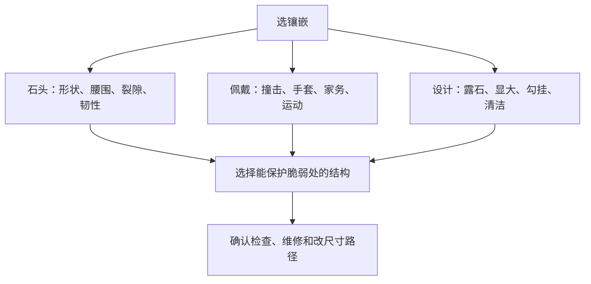

# 第 39 章 镶嵌工艺：看牢固、保护与外观取舍

镶嵌既决定宝石被怎样固定，也决定它露出多少、是否容易勾挂和以后如何维修。没有“最牢又最显大”的万能
镶法：石头形状、脆弱位置、日常活动、金属结构和审美要一起权衡。

## 39.1 镶嵌方式与设计风格不是一回事

爪镶、包镶、轨道镶、钉镶/微钉镶、槽镶和张力镶描述固定宝石的方式；单钻、光环、三石等往往描述整体
设计。购买时应分别问“石头靠什么固定”和“这套设计怎样影响维修/清洁”。[^setting]

| 方式 | 外观与优势 | 要重点看的边界 |
|------|------------|----------------|
| 爪镶 | 露石较多、视觉轻盈 | 爪尖磨耗/弯折、爪位是否覆盖脆弱角 |
| 包镶/半包镶 | 金属包住部分或周边，边缘保护较好 | 覆盖会改变侧面可见度，改尺寸和维修需评估 |
| 轨道/槽镶 | 小石连续排列、表面较平顺 | 槽壁、石距与整体结构；缺石后维修路径 |
| 钉镶/微钉镶（pavé） | 许多小石营造铺满效果 | 金属颗粒和细小石位受摩擦，活跃佩戴应更频繁检查 |
| 张力镶 | 视觉上金属较少、悬浮感强 | 靠金属弹力和精确结构固定，维修/改圈限制须先问清 |

## 39.2 保护脆弱处，比“几爪”更重要

尖角、尖端、很薄腰围、裂隙或接近表面的内含物可能增加受撞击风险。以公主方等尖角钻石为例，GIA 建议用
V 形爪、包镶或半包镶等方式保护角部；六爪在某些圆钻设计中可提供比四爪更多冗余，但爪数本身不替代爪的
厚度、座位贴合和整体设计。[^protection]

不同宝石的韧性、解理和已知处理也不同。祖母绿、坦桑石、锂辉石等更脆弱材料不应简单复制钻石戒托逻辑；
由合格镶嵌师评估石材状态、腰围与边缘，往往比套用流行镶法更重要。

## 39.3 “显大”是视觉效果，不是增加重量

高托、光环、小钻围边、细戒臂、较少金属遮挡和明亮柜台灯都可能使主石显得更大或更亮；它们不会改变主石
实际克拉重量、直径或报告信息。高托可能增加侧面可见度，也更容易碰撞；光环和密钉镶带来更多石位与维护点。
应在自然/漫射光下看整体比例，同时从侧面观察主石高度、爪位和佩戴勾挂风险。

## 39.4 掉石通常是“结构 + 磨耗 + 事件”的问题

松动或掉石可能来自爪磨损/弯折、石座不贴合、长期撞击、金属疲劳、设计过薄、维修或清洁操作不当等，不能
仅凭一次事件归因为“石头不好”或“品牌不好”。GIA 的镶嵌质控资料强调，石座与宝石轮廓贴合、足够的爪接触
和完成后检查对安全性都重要。[^qa]

若发现宝石晃动、爪尖勾丝/明显变薄、槽镶石位不齐、异响或掉石：停止佩戴，收好掉落宝石和首饰，拍照记录，
尽快找原商家或合格维修方检查。不要用胶水、自行掰爪或超声清洗来“修好”。

## 39.5 常见说法辨析

| 说法 | 判定 | 为什么 |
|------|------|--------|
| “爪越多一定越牢” | **不准确** | 爪数只是变量之一；爪的厚度、座位贴合、石头形状和整体结构同样关键。 |
| “包镶一定比任何爪镶安全” | **不准确** | 包镶通常保护边缘较好，但具体强度仍取决于金属、厚度、加工与石材条件。 |
| “高托显大，所以是更优切工” | **明确错误** | 高度和设计改变视觉比例，不改变主石的切工/重量事实。 |
| “掉石后用胶粘回去即可” | **危险** | 胶水可能污染宝石和镶口、掩盖松动原因，并增加专业维修难度。 |

## 39.6 🔎 柜台前的用处

1. 看主石的尖角、腰围和侧面是否被适当保护，尤其是尖角形状和脆弱宝石；
2. 轻看而不摇晃宝石：检查是否水平、石位是否对称、爪是否平顺勾手；
3. 问清改圈、补爪、补石、清洗和翻新的限制与费用；
4. 对密钉镶和多石款，把定期检查写入佩戴计划；
5. 松动或掉石时停戴、留存全部部件和凭证，交专业人员检查。

## 39.7 思考题

1. 为什么不能只按“几爪”判断镶嵌安全性？
2. 为什么“显大”不等于主石实际更大？
3. 【案例】一枚公主方钻戒使用四个很细的普通爪，佩戴后常勾毛衣，石头轻碰会响。你如何处理？

> 📖 **参考答案**（想清楚再看）：[Q1](../../qa/39-setting-qa.md#q1) · [Q2](../../qa/39-setting-qa.md#q2) · [Q3](../../qa/39-setting-qa.md#q3)

## 39.8 本章实操

### 🅐 无器具版

为一个主石戒指和一件多石首饰各画简图，标出石头尖角、爪/包边/槽壁、最高点和高摩擦位置；写下适合它的
佩戴场景、需问的维修问题和一次年度检查计划。

### 🅑 有器具版

备齐后再做：用 10 倍镜和侧向光观察爪尖、石座接触、包边连续性、槽镶石距及勾丝处，拍照留档；不要摇石、
掰爪、用针探缝或以超声清洗测试牢度。任何松动均应停止佩戴并交专业人员检查。

## 39.9 本章主要参考

| 来源 | 本章用途 |
|------|----------|
| [GIA：How to Protect Your Diamond from Chipping](https://www.gia.edu/gia-news-research/how-protect-diamond-chipping) | 尖角、腰围、V 形爪/包镶保护与停戴检查原则 |
| [GIA：Gemstone Durability—Design to Display](https://www.gia.edu/doc/Gemstone-Durability-Design-to-Display.pdf) | 宝石韧性、爪镶压力与保护腰围的设计边界 |
| [GIA：Side Stone Settings](https://4cs.gia.edu/en-us/blog/side-stone-settings-for-engagement-rings/) | pavé、轨道镶与无边镶的视觉/耐久取舍 |
| [GIA：Avoid Stone Loss with Quality Assurance Benchmarks](https://www.gia.edu/gia-website/bench-tip-avoid-stone-loss-with-quality-assurance-benchmarks) | 石座贴合、爪接触与镶嵌质控要点 |

[^setting]: “镶嵌方式”和“款式”常在营销中混用，比较时应回到实际固定结构。
[^protection]: 保护效果是相对的；强撞击仍可损坏任何宝石或镶口。
[^qa]: 专业质控参数适用于具体结构，消费者不应自行以固定数值判断所有首饰。
