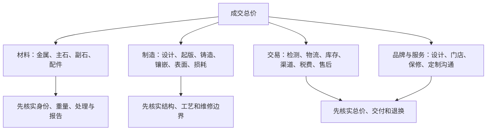

# 第 40 章 成本结构：把“价格”拆成可比较的项目

一件首饰的标价不是“金价 + 石价”的简单加法。材料、工艺、损耗、设计、检测、库存、渠道、税费、售后和
品牌服务都会进入经营定价；不同渠道的项目和风险分配也不同。本章不提供“合理价百分比”或投资建议，而是
教你把两个报价改写成同一张证据卡后再比较。

## 40.1 价格由哪些层次构成

这张图不是会计成本表，也不能从外部精确反推一家商家的利润。它的作用是防止把所有差价都归结为“品牌溢价”
或“石头更好”。同一重量不代表同一材料口径；同一证书等级不代表同一镶嵌、售后或渠道；同一款式也可能因
尺寸、金属、主副石匹配和库存状态而不同。

## 40.2 先把“材料可比”做对

金属应比较类别、纯度表达、重量口径、是否含宝石/配件、是否有镀层或空心结构；宝石应比较材料身份、天然/
实验室生长、处理、重量/尺寸、品质信息、报告及报告与实物是否对应。副石往往以总重或数量说明，不能把总重
直接当成主石参数。

材料的市场价格会波动，且采购、损耗、加工、税费和零售时点不相同。即使知道某日公开金价或同类裸石报价，
也不能直接推导成一件成品的“唯一合理零售价”。把动态价格当作背景信息可以，拿它替代商品规格核验不可以。

## 40.3 工费、设计和品牌：要问服务边界，不要猜利润

工费可能覆盖起版、复杂结构、手工修整、镶嵌、抛光、检测、定制沟通和损耗；品牌/渠道部分可能对应设计、
门店体验、库存、售后网络和营销。它们是否值得，取决于你是否需要且能否得到明确服务，而不是一个抽象的
“溢价率”。

对定制件尤其要书面确认：图纸/尺寸、金属和宝石规格、报价含什么、不含什么、最终重量偏差如何结算、改稿和
返工次数、余料/旧料归属、交付日期、验收与售后。只有“按克计价”不能覆盖这些条件。

## 40.4 总价、估价、回收与保额不是同一个数字

零售成交价回答“这一次按什么条款买到”；保险替换估价通常服务于保险目的；回收/寄售报价取决于回收方当期
渠道、材料、证书、状态和再销售风险。三者用途不同，不能用一张高保额估价单证明能按同额变现，也不能用
回收报价否定佩戴、设计和售后服务的零售价值。[^appraisal]

若购买目的包含转售或回收，应在付款前单独询问回收主体、依据、扣减项、证书/发票要求及是否承诺；不要把
销售人员的泛称“保值”理解成保本、流动性或未来价格承诺。

## 40.5 一张可比较的报价卡

| 字段 | 报价 A | 报价 B |
|------|--------|--------|
| 总价与价格有效期 |  |  |
| 金属类别、纯度、总重口径 |  |  |
| 主石身份、处理、重量/尺寸、报告 |  |  |
| 副石数量/总重及匹配说明 |  |  |
| 镶嵌、表面、是否空心/镀层 |  |  |
| 工费/定制/检测/物流等是否另计 |  |  |
| 发票、货号、交付与验收 |  |  |
| 退换、改圈、补镀、补石与保修 |  |  |
| 回收/寄售承诺（如有） |  |  |

只有当两张卡的关键空格都补齐，才适合比较“每克”“每克拉”或总价。无法补齐时，正确结论通常是“不可比”，
不是强行算出一个看似精确的单价。

## 40.6 常见说法辨析

| 说法 | 判定 | 为什么 |
|------|------|--------|
| “按克卖就没有品牌或工费” | **明确错误** | 成品交易仍可能包含加工、结构、渠道、税费和服务，只是呈现方式不同。 |
| “证书估价就是以后能卖出的价格” | **明确错误** | 估价目的可能是保险替换，和回收/寄售/拍卖的条件不同。 |
| “回收价低，说明零售价全是骗局” | **不准确** | 两种交易包含的服务、时间、渠道和风险不同；仍应核对自己是否愿意为它们付费。 |
| “直播间写最低价就一定最划算” | **缺乏证据** | 需先核对同一材料、重量、处理、结构、总价、退换和售后，不能只比较标题价。 |

## 40.7 🔎 柜台前的用处

1. 先问总价及所有必付项目，再讨论“克价”“折扣”或赠品；
2. 将材料、工艺、服务分别写入报价卡，避免把口头承诺混成一个数字；
3. 把成交价、保险估价和回收/寄售条件分开存档；
4. 定制件把重量偏差、改稿、余料、交期和验收写入订单；
5. 对“保值、原价回收、终身免费”等主张要求书面条件、适用范围和例外。

## 40.8 思考题

1. 为什么不能只用“每克价格”比较两件镶宝石首饰？
2. 为什么保险替换估价不等于即时回收报价？
3. 【案例】两枚戒指总价相近：A 只写“18K 金钻戒、总重 3g”，B 列出金属纯度、主副石报告、改圈和补镀服务。你如何比较，而不假装知道各自利润？

> 📖 **参考答案**（想清楚再看）：[Q1](../../qa/40-cost-structure-qa.md#q1) · [Q2](../../qa/40-cost-structure-qa.md#q2) · [Q3](../../qa/40-cost-structure-qa.md#q3)

## 40.9 本章实操

### 🅐 无器具版

选择两件预算相近的首饰，完整填写本章报价卡。将所有“不清楚”的字段列成向销售询问的问题；不以截图中的
划线价、主播口头“保值”或单一克价替代答案。

### 🅑 有器具版

备齐后再做：以电子秤记录已拥有首饰的整件重量，以卡尺记录可见尺寸，并与发票/报告的重量口径核对；这些
记录用于身份和售后核对，不用于推算成分、成本或未来回收价。贵重件可咨询独立鉴定/估价专业人士，先说明
所需的是保险、分家、税务还是市场交易用途。

## 40.10 本章主要参考

| 来源 | 本章用途 |
|------|----------|
| [GIA：Jewelry Appraisal Guide](https://4cs.gia.edu/en-us/blog/appraisal-tips/) | 估价目的、替换价值/市场价值、报告内容与限制条件 |
| [GIA：Engagement Ring Buying Questions](https://4cs.gia.edu/en-us/blog/buying-diamond-engagement-ring-questions-jeweler-will-ask/) | 证书、服务与保险替换价值的消费者教育 |
| [FTC：Buying Gemstones, Diamonds, and Pearls](https://consumer.ftc.gov/articles/buying-gemstones-diamonds-and-pearls) | 卖方、书面退换政策与材料披露的购买前核验原则 |

[^appraisal]: 同一物件可因估价目的、日期、市场和限制条件得出不同数值；委托前应说明用途并阅读限制声明。
