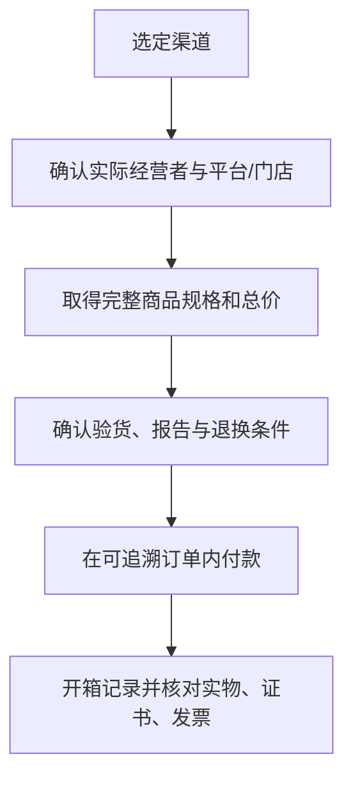

# 第 41 章 渠道全景：比较信息与履约能力，不给渠道贴好坏标签

品牌门店、批发集散地、电商、直播、拍卖和跨境购买不是品质等级，而是不同的信息、验货、付款、交付与售后
安排。渠道能影响价格和风险，却不能替代对具体货品的材料、报告和结构核验。

## 41.1 用同一组问题比较渠道

| 维度 | 要核对什么 | 不能由渠道自动推出什么 |
|------|------------|------------------------|
| 货品信息 | 材质、重量、处理、报告、实拍/视频 | 一定天然、一定高性价比 |
| 经营主体 | 名称、联系方式、订单和发票主体 | 主播/销售个人就是卖方 |
| 验货条件 | 自然光、放大观察、复检、交付前后节点 | 可随时无条件退货 |
| 价格 | 总价、必付费用、税/运费、有效期 | 某一克价可横向比较一切 |
| 履约与售后 | 发货、验收、退换、维修、争议入口 | “平台保障”覆盖所有货品与情形 |

## 41.2 各渠道的典型能力与盲区

门店通常便于试戴、当场观察和维修沟通，但仍应核对报价和书面售后。集散地/批发型渠道可能提供更丰富的
供应与灵活定制，消费者则更要明确交易主体、证据和复检节点。普通电商便于保存页面、订单和聊天记录，但
照片与屏幕颜色不能替代实物验收。直播能展示动态细节，却受灯光、滤镜、节奏和即时口头承诺影响；必须回到
商品链接、订单、录屏和书面规格。拍卖与跨境交易还可能叠加佣金、税费、物流、真伪/状态报告边界和适用法。

中国网络交易规则要求经营者显著展示实际经营主体、商品/服务与售后等信息；直播规则还要求显著展示品名、
价格和计价单位/方法，并规范经营主体信息公示。[^rules] 这不意味着每次交易都无风险，而是给消费者提供了
应当查找、保存并用于争议处理的信息入口。

## 41.3 线上、直播交易的最低动作

1. 在平台内查看实际经营者、商品链接、售后规则与评价，不按私聊链接转账；
2. 要求将材质、处理、重量、证书编号、尺寸和货号写回商品页、订单或客服文字；
3. 保存商品页、直播回放/录屏、聊天、付款、快递面单和开箱视频；
4. 贵重或定制货确认复检、验收与争议时间点后再付款；
5. 收货时连续记录外包装、封签、货号、印记、证书与实物，异常先在平台内发起处理。

## 41.4 常见说法辨析

| 说法 | 判定 | 为什么 |
|------|------|--------|
| “品牌店一定不需要看证书和条款” | **不准确** | 渠道不替代对具体货品、报告和售后的核对。 |
| “直播看到实物，就等于线下验货” | **明确错误** | 灯光、滤镜、镜头与节奏会影响观察，且无法替代触摸、测量和报告对应。 |
| “批发地一定更便宜，所以必然更划算” | **不准确** | 还须比较规格、总价、税费、售后、复检和交易风险。 |
| “私下转账更有优惠，平台订单不重要” | **危险** | 可能丢失订单、支付和争议处理证据，应优先可追溯交易路径。 |

## 41.5 🔎 柜台前的用处

用“主体—货品—总价—验货—售后”五格表筛选渠道；任一格不能书面回答，就将它计入风险而非当作小问题。

## 41.6 思考题

1. 为什么“在哪买”不能替代“买的是什么”？
2. 直播交易应保存哪些与珠宝身份相关的证据？
3. 【案例】主播要求私信转账以拿“最低价”，链接页没有证书与退换信息。你怎么做？

> 📖 **参考答案**（想清楚再看）：[Q1](../../qa/41-channels-qa.md#q1) · [Q2](../../qa/41-channels-qa.md#q2) · [Q3](../../qa/41-channels-qa.md#q3)

## 41.7 本章实操

### 🅐 无器具版

为同一预算选三种渠道，各填一次五格表；只按可获得的书面信息打勾，不以口碑、粉丝量或装修替代证据。

### 🅑 有器具版

备齐后再做：线上收货开箱时使用手机连续录制，并用 10 倍镜记录印记、石位与证书编号；不拆改、佩戴或清洗
有争议的物件，先按平台与卖方书面规则处理。

## 41.8 本章主要参考

| 来源 | 本章用途 |
|------|----------|
| [市场监管总局：网络交易监督管理办法](https://www.samr.gov.cn/wljys/gzzd/art/2023/art_09c394cce74f424a8d82dbc4811a11ec.html) | 网络交易中经营主体、商品和售后信息展示的规则 |
| [网信办：直播电商监督管理办法](https://www.cac.gov.cn/2026-01/07/c_1769516655383334.htm) | 直播主体、商品、价格/计价信息公示与记录要求 |
| [市场监管总局/中消协直播消费提示](https://www.samr.gov.cn/xw/mtjj/art/2025/art_8cca7cffb41642f2ae2cc394cac810e1.html) | 不经非正规链接交易、保存证据等消费者提示 |

[^rules]: 规则与适用范围会更新；具体争议仍应以订单、平台规则及适用法律为准。
