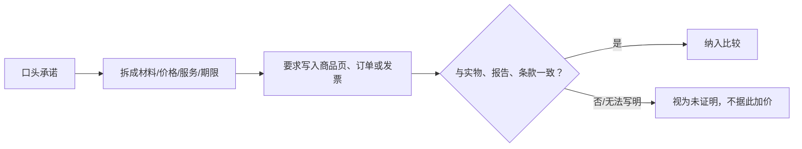

# 第 42 章 话术识别与议价：把承诺翻译成可核验字段

好的议价不是压着销售人员报出一个数字，而是先确认你买的究竟是什么、总价包含什么、承诺由谁履行。对珠宝，
最有用的回应通常是“请写明并对应到这件货”，而不是与“全网最低”“最后一件”争论真假。

## 42.1 四步翻译法

| 听到的话 | 转成的问题 | 应留下的证据 |
|----------|------------|--------------|
| “天然、A货、无优化” | 报告定名、备注、机构与实物是否对应？ | 可官网核验的报告与照片 |
| “全网最低、今天最后价” | 同一规格的总价、有效期、比较基准？ | 商品页、报价单、促销规则 |
| “保值、原价回收” | 谁回收、什么条件、扣减与期限？ | 书面回收条款 |
| “终身保修、不掉色” | 覆盖何种问题、哪些除外、谁承担物流/工费？ | 售后条款与订单 |

## 42.2 促销与“原价”：问比较基准，不猜折扣率

市场监管规则要求价格比较的被比较价格真实准确；无依据或无法比较的价格不能作为折价/减价基准，经营者也
不得用虚假折价、误导性价格信息或隐藏不利价格条件诱导交易。[^price] 对消费者而言，这意味着“原价”“专柜价”
“直播专享”本身不是价值证据：应问清比较对象、规格、有效期、必付费用和适用条件。

议价可围绕可验证内容：总价、材料/重量口径、报告、交付时间、改圈/补镀/复检、退换与赠品。不要为了获得
“优惠”接受私下付款、删减发票描述或放弃关键售后。

## 42.3 红旗词不是结论，无法核验才是风险

“收藏级”“孤品”“大师工”“满色”“老矿”“内部渠道”“最后一件”可能只是审美或营销描述，也可能有可核验
依据。正确动作是追问其对应的材料、报告、作者/来源、时间、尺寸、处理、价格基准或条款。若无可验证定义，
就把它当作主观描述，而非独立溢价理由。

市场监管总局的珠宝消费提示明确建议核验检测机构资质、报告内容/照片/备注及贵金属计价方式，并警惕仿冒
报告和营销话术。[^samr] 这不授权消费者隔屏断言假货；它要求在证据不足时暂停把高风险主张计入价格。

## 42.4 常见说法辨析

| 说法 | 判定 | 为什么 |
|------|------|--------|
| “最低价，所以无需看规格” | **明确错误** | 价格只在同一货品、总价和条款下才可比较。 |
| “证书有二维码就一定可靠” | **不准确** | 还需在机构官方入口核验编号、照片和实物对应。 |
| “不退不换，所以必须马上决定” | **危险** | 先阅读适用条款与定制边界；急迫感不替代知情决策。 |
| “砍价成功就说明买得值” | **不准确** | 仍须看成交后实际拿到的材料、服务和凭证。 |

## 42.5 🔎 柜台前的用处

可直接使用三句话：“请写明材质/处理/重量与货号。”“这个原价比较的是什么、总价含哪些项目？”“售后和回收
承诺能否写进订单？”答复无法落字时，将该承诺从比较表中删除。

## 42.6 思考题

1. 为什么“全网最低价”不是购买理由？
2. 为什么议价时不应以删减发票描述换折扣？
3. 【案例】销售称“天然无优化、今天最后价、原价回收”，却只愿口头保证。你如何回应？

> 📖 **参考答案**（想清楚再看）：[Q1](../../qa/42-sales-claims-qa.md#q1) · [Q2](../../qa/42-sales-claims-qa.md#q2) · [Q3](../../qa/42-sales-claims-qa.md#q3)

## 42.7 本章实操

### 🅐 无器具版

收集三条商品话术，分别填“原话—可验证字段—所需文件—不能证明什么”。在未补齐文件前，不给任何话术加分。

### 🅑 有器具版

备齐后再做：以手机保存价格页、规格、报告查询结果和客服书面答复；用 10 倍镜记录可见印记与石位，仅用于
货品对应。不做破坏性验货或私下转账。

## 42.8 本章主要参考

| 来源 | 本章用途 |
|------|----------|
| [市场监管总局：明码标价和禁止价格欺诈规定](https://www.samr.gov.cn/zw/zfxxgk/fdzdgknr/fgs/art/2023/art_9a1f82a007964950a1a0f6c056f2fedf.html) | 价格比较、折价基准与误导性价格信息的规则 |
| [市场监管总局：防范珠宝贵金属首饰消费陷阱](https://www.samr.gov.cn/xw/sj/art/2025/art_4d5688e376de4085b4214ddc375462a3.html) | 报告、印记、计价方式及营销话术的核验路径 |
| [市场监管总局/中消协直播消费提示](https://www.samr.gov.cn/xw/mtjj/art/2025/art_8cca7cffb41642f2ae2cc394cac810e1.html) | 最低价、限时话术与证据留存提示 |

[^price]: 条款与适用范围以交易发生时的有效规则为准。
[^samr]: 报告和销售凭证须对应具体货品；无法对应时应暂停交易或复检。
