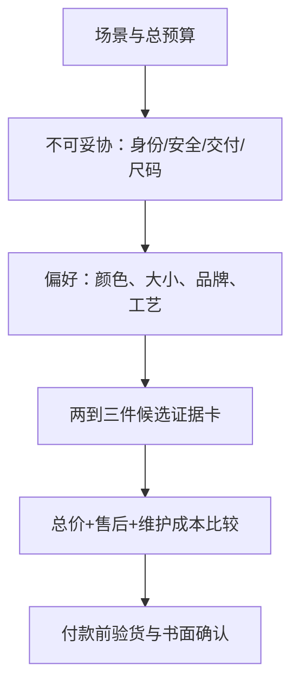

# 第 44 章 场景实战：先定义任务，再选参数与渠道

没有脱离场景的“最优首饰”。求婚、婚嫁、送礼和自戴的预算、佩戴强度、尺码确定性、时间、共同决策程度和
售后需求不同。先定义任务，可避免把别人的参数清单当成自己的答案。

## 44.1 四类任务的决策起点

| 场景 | 先问的问题 | 常见优先级 |
|------|------------|------------|
| 求婚 | 对方参与度、戒围、风格、是否日常戴、交付时间？ | 尺码/审美不确定性、可改圈、耐久与退换 |
| 婚嫁 | 地方习惯、预算口径、套装/克重、交付节点？ | 规格透明、总价、佩戴/置换条件 |
| 送礼 | 对方偏好、过敏/职业限制、是否可交换？ | 尺寸风险低、凭证、礼品退换与保养 |
| 自戴 | 高频活动、维护意愿、已拥有首饰的搭配？ | 舒适、耐久、可维修、真实偏好 |

## 44.2 先设“不可妥协项”，再排可让步项

例如日常高频佩戴的尖角宝石戒指，可把保护性镶嵌和维修能力列为不可妥协项；时间紧且戒围未知的礼物，可把
可换款/改圈政策列在主石参数之前。预算不足时优先缩小“想要更多”的规格，而不压缩材料身份、处理披露、
安全结构和可追溯订单。

## 44.3 四个常见误区

| 误区 | 更好的做法 |
|------|------------|
| 只按别人的预算或克拉数买 | 写下自己的总预算、场景、时间和不可妥协项 |
| 为“显大”牺牲戒壁/镶嵌安全 | 同时看侧面结构、勾挂、改圈与维修 |
| 婚嫁只看克重或总价 | 核对纯度、重量口径、计价方式、套装明细与置换规则 |
| 送礼为了惊喜不留凭证 | 保留订单、报告和可交换/改尺路径 |

## 44.4 🔎 柜台前的用处

带着一张“场景—预算—不可妥协—可让步—交付日—售后”卡去比较。销售推荐若改变了任一不可妥协项，就要求
它回到书面规格中重新比较，而不是靠“更划算”代替。

## 44.5 思考题

1. 为什么求婚戒与日常自戴戒不能照抄同一参数表？
2. 预算紧张时哪些项目不应被“省掉”？
3. 【案例】两周后要送一枚戒指，但戒围、偏好都不确定。你如何制定低风险方案？

> 📖 **参考答案**（想清楚再看）：[Q1](../../qa/44-scenarios-qa.md#q1) · [Q2](../../qa/44-scenarios-qa.md#q2) · [Q3](../../qa/44-scenarios-qa.md#q3)

## 44.6 本章实操

### 🅐 无器具版

任选一种场景，写下预算上限、交付日、三项不可妥协、三项可让步及验收清单；用第 40 章报价卡比较两项候选。

### 🅑 有器具版

备齐后再做：试戴/模拟佩戴时记录戒围、活动范围、勾挂点和侧面高度；用 10 倍镜仅观察爪位与印记，避免自行
调整结构。将观察与订单规格一并留存。
